# KusBill User Guide

**Your Bills. Your Balance. Automatically.**

This guide is for the people who use KusBill every day: the shop owner, the accountant and anyone who only needs to look at the figures. No accounting or computer knowledge is needed.

> The screenshots show a sample shop called *Kus Traders*. Your own figures will be different.

---

## Contents

1. [What KusBill does](#1-what-kusbill-does)
2. [Signing in and first-time setup](#2-signing-in-and-first-time-setup)
3. [The dashboard](#3-the-dashboard)
4. [Adding a bill (Billpad Entry)](#4-adding-a-bill-billpad-entry)
5. [The ledger: viewing and correcting entries](#5-the-ledger-viewing-and-correcting-entries)
6. [Bulk entry: a whole page at once](#6-bulk-entry-a-whole-page-at-once)
   - [6a. Customers and suppliers (Parties)](#6a-customers-and-suppliers-parties)
7. [Importing old billpad records](#7-importing-old-billpad-records)
8. [Reports, printing and downloads](#8-reports-printing-and-downloads)
9. [Alerts and reminders](#9-alerts-and-reminders)
10. [Accounts and categories (profit and loss)](#10-accounts-and-categories-profit-and-loss)
11. [Settings](#11-settings)
12. [Nepali language](#12-nepali-language)
13. [When the internet stops](#13-when-the-internet-stops)
14. [Using a phone](#14-using-a-phone)
15. [Quick reference](#15-quick-reference)
16. [Questions and problems](#16-questions-and-problems)
17. [Short guide in Nepali](#17-short-guide-in-nepali)
18. [Glossary](#18-glossary)

---

## 1. What KusBill does

You already keep a paper **billpad** with columns for *Date, Bill No., Debit, Credit and Balance*. You add up the balance by hand, check the bill numbers, and prepare the yearly statement yourself.

KusBill does the same job on a screen:

1. You type the **date, bill number and amount** from the billpad.
2. KusBill **saves** it safely in a database. It is never stored only in the browser.
3. The **balance is calculated automatically** after every entry.
4. At the end of the month or year, the **reports are ready**: daily, monthly, yearly, profit and loss, and a printout that looks like your billpad.

You can use it on a computer or a phone. It works in **English and Nepali**.

---

## 2. Signing in and first-time setup

### Sign in

Open the KusBill address in your browser, type your **email and password**, and press **Sign in**.

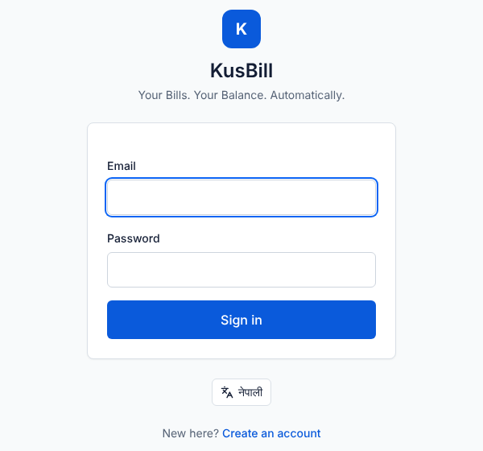

- Use **नेपाली / English** under the form to change the language.
- If the owner has allowed it, a **Create an account** link lets a new person register. A new account starts with its own, empty set of books, so nobody can see anyone else's records.
- Please do not share your password. You can change it any time in **Settings → My account**.

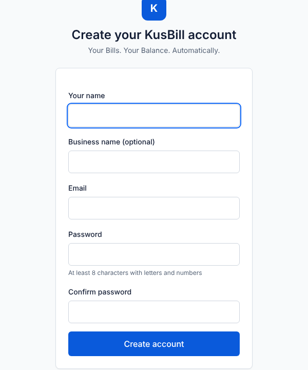

### Guided setup (3 short steps)

A new account opens the **Welcome** screen. It asks for three things, and every step can be skipped and done later.

**Step 1: Your business.** Type the business name and choose whether dates are shown in **Bikram Sambat (BS)** or **Gregorian (AD)**.

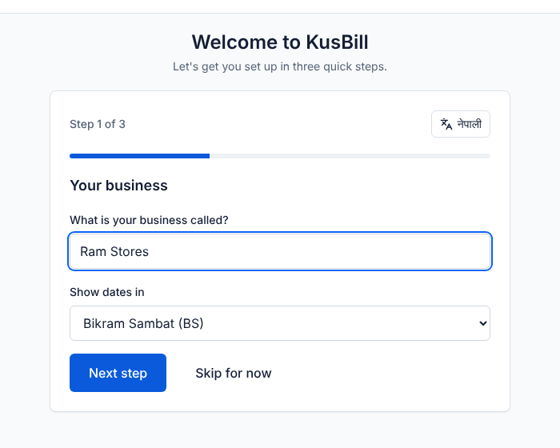

**Step 2: Opening balance.** Look at the first page of your billpad. If a balance is brought forward, type it here. If you are starting fresh, leave it at 0.

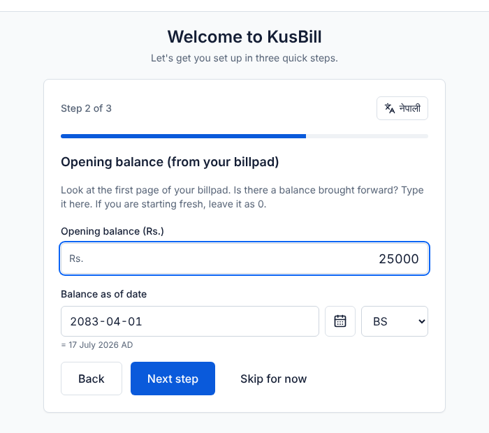

**Step 3: Your first entry.** Type one bill so you can see how it works. You can change or delete it later.

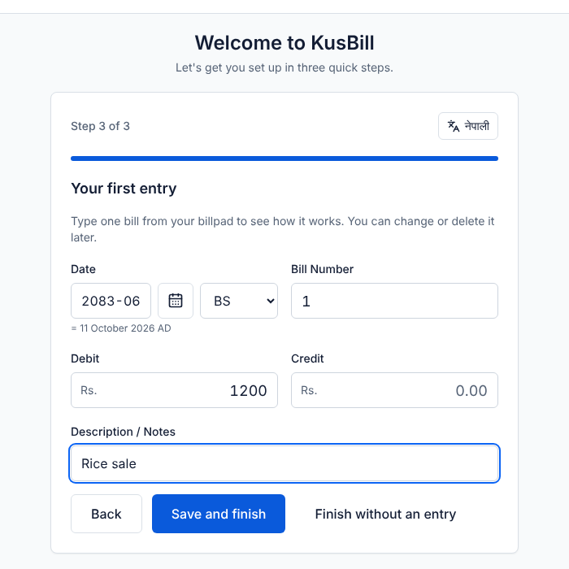

Until all three steps are done, the dashboard shows a small checklist with a **Start guided setup** button. You can hide it with **Hide**.

---

## 3. The dashboard

The dashboard is the first page after you sign in. Everything on it is calculated from your saved entries for the period you choose.

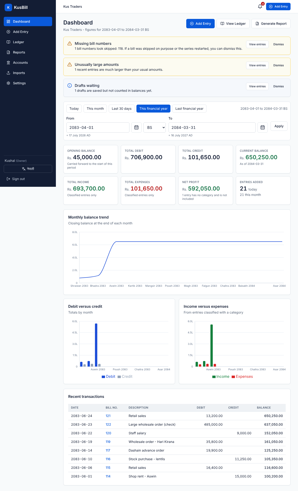

| Card | Meaning |
|---|---|
| **Opening Balance** | The balance carried forward to the start of the chosen period |
| **Total Debit / Total Credit** | Sum of all debit and credit amounts in the period |
| **Current Balance** | Balance at the end of the period |
| **Total Income / Total Expenses** | From entries that have an income or expense **category** (see [section 10](#10-accounts-and-categories-profit-and-loss)) |
| **Net Profit / Loss** | Income minus expenses. It shows **"Insufficient data"** until entries are categorised, so it never pretends the balance is profit |
| **Entries added** | How many entries were added today and this month |

**Choosing the period:** use the buttons at the top (*Today, This month, Last 30 days, This financial year, Last financial year*) or type your own *From* and *To* dates. Dates can be typed in BS or AD, and the calendar button opens a date picker.

Below the cards are three charts (balance trend, debit versus credit, income versus expenses) and the **recent transactions**.

The bell icon in the top bar and the yellow boxes under the title show [alerts](#9-alerts-and-reminders).

---

## 4. Adding a bill (Billpad Entry)

Click **Add Entry** (top right, always visible) to open the entry page. It is designed so you can look at the physical billpad and type, row by row.

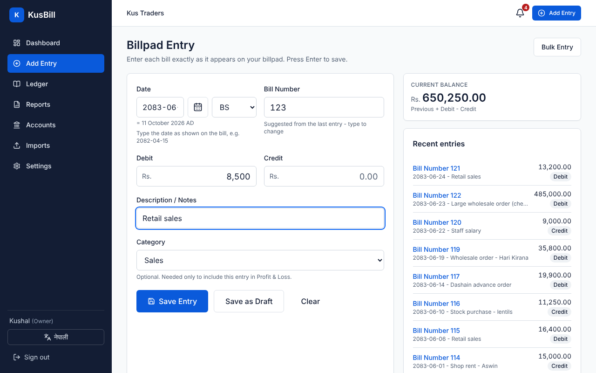

### The fields

| Field | What to type |
|---|---|
| **Date** | The date on the bill. Type it as `2083-06-25`. The line under the box shows the same day in the other calendar (for example *= 12 October 2026 AD*) so you can check it. |
| **Bill Number** | The number on the bill. KusBill **suggests the next number** from your last entry; just type over it if it is different. Numbers can skip or restart. |
| **Debit** or **Credit** | The amount from the billpad column. Enter **one of them, not both**. Up to two decimals, for example `12,500.50`. |
| **Description / Notes** | Optional: customer or item name. |
| **Category** | Optional. Choose *Sales, Purchases, Rent…* only if you want the entry included in **Profit & Loss**. |

Press **Enter** (or **Save Entry**). A green message confirms the save, the balance updates, and the form is ready for the next bill with the **date kept** and the **next bill number** filled in.

### Debit and credit: what they mean here

A billpad's *Debit* and *Credit* do not automatically mean "expense" and "income". KusBill simply follows your billpad's rule:

> **Balance = Previous Balance + Debit − Credit**

If your billpad works the other way round, the owner can change the rule in **Settings → Balance rule**. The rule in use is printed on every ledger and report.

### Date picker

Click the **calendar button** next to any date box to pick a day instead of typing. The picker works in **BS and AD**, and each date shows the other calendar's day in small numbers underneath.

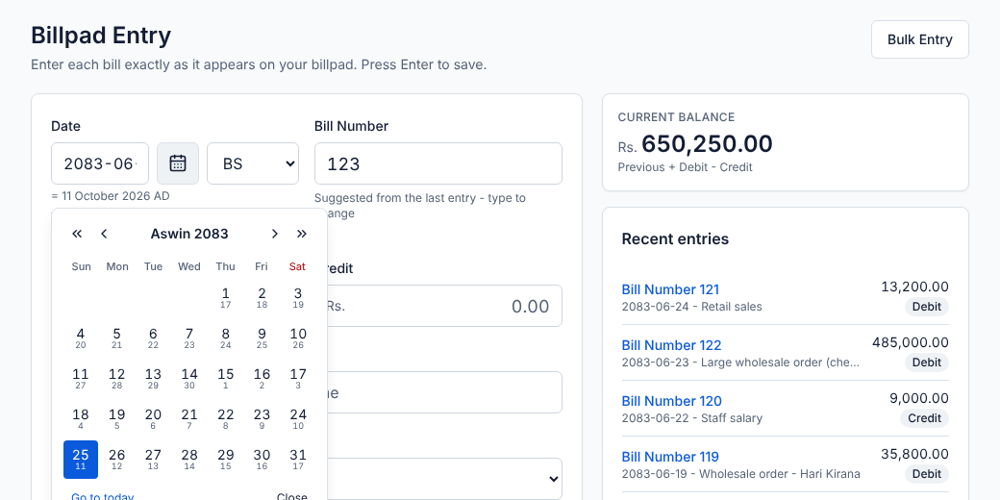

### Warnings you may see

- **Bill number already used.** KusBill shows the earlier entry and asks whether you want to *Save anyway* or *Change bill number*. This protects you from entering the same bill twice by mistake.
- **An identical entry already exists** (same date, bill number and amount). Check it before choosing *Save anyway*.

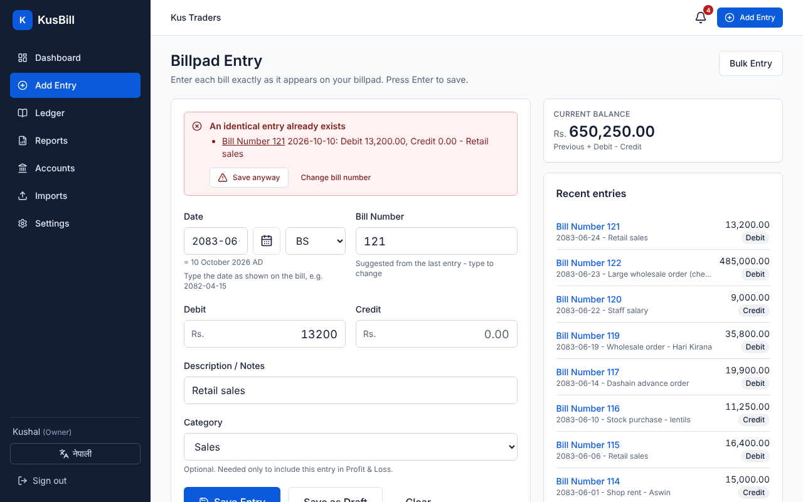

- **Wrong date or amount.** The field turns red with a clear message. **Nothing you typed is lost** while you fix it.
- **Date before the opening balance date.** Entries cannot be dated earlier than the opening balance (see [Settings](#11-settings)).

### Save as Draft

Not sure about a bill? Press **Save as Draft**. A draft is stored but **not counted in balances** until you open it and press **Save & post entry**. Find drafts in the ledger by choosing **Drafts** in the status filter.

---

## 5. The ledger: viewing and correcting entries

Click **Ledger** to see every entry with its **running balance** (Date, Bill No., Description, Debit, Credit, Balance).

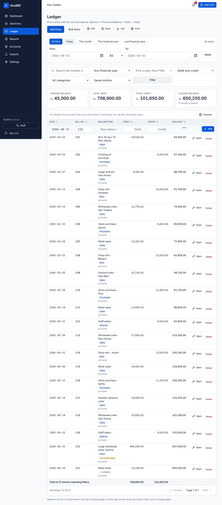

> Balances are always worked out from your **complete** history, so they stay correct when you search, filter, sort or change pages.

### Quick add row

The **blue row at the top** lets you add an entry without leaving the ledger: type the bill number, amount and description and press **Enter**. The cursor jumps back to *Bill No.* for the next one.

### Correcting an entry in place

**Double-click** any cell (or move to it with the arrow keys and press **Enter**), type the new value and press **Enter** to save. **Esc** cancels.

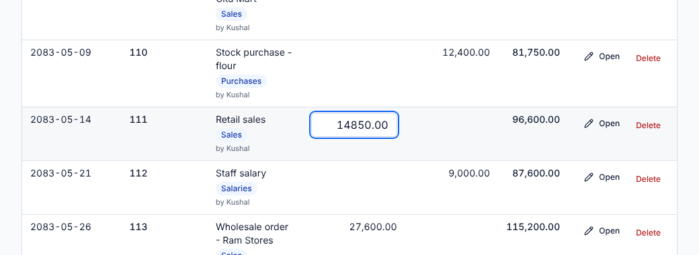

- All later balances are **recalculated automatically**.
- You can also click **Open** on a row to see the full entry, who created or changed it, and its **history**.
- Click the small **+ category** tag to assign or change the category.

### Deleting and reversing

- **Delete** removes an entry from the balances and reports. You must type a **reason**. The entry is **not erased**: it stays in the history, and you can see it under **Deleted** in the status filter.
- **Reverse** (on the entry page) adds a new entry with debit and credit swapped, so the balance returns to what it was and the original stays visible. Use it when you want a clear paper trail.

Every create, edit, delete and reversal is recorded with **who did it and when**.

### Searching and filtering

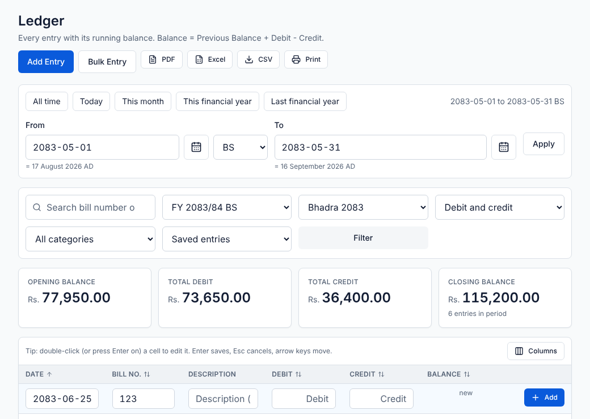

- **Search** box: type a bill number or any word from the description. Results appear as you type.
- **Date range** buttons, or **Financial year** and **Month** drop-downs (pick a year, press *Filter*, then pick a month).
- **Debit and credit / Debit only / Credit only**, **Category**, and **Status** (Saved entries, Drafts, Deleted).
- Click a **column heading** to sort by date, bill number, debit, credit or balance.
- **Columns** lets you hide the description, the category tags, or the "who changed it" line.

Small tags on a row warn you of **Duplicate bill no.**, **Unusually large**, **Future date**, **Draft** or **Reversal**.

### Printing and downloading the ledger

At the top right: **PDF, Excel, CSV, Print**. They contain exactly the entries currently shown with the current filters.

---

## 6. Bulk entry: a whole page at once

Use **Ledger → Bulk Entry** (or the *Bulk Entry* button on the entry page) to type or paste many bills at once, like filling a page of the billpad.

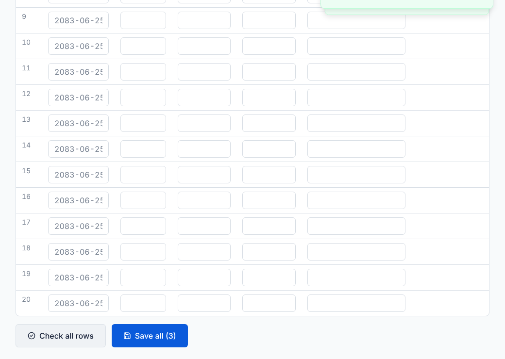

1. Set the **Date for rows without their own date** at the top.
2. Type in the grid: *Bill No., Debit, Credit, Description*. Press **Enter** to go down a row.
3. **Paste from Excel:** copy rows in a spreadsheet and paste into the first cell. The columns fill automatically.
4. **Number rows starting from…** fills in consecutive bill numbers for you.
5. Press **Check all rows.** Every row is checked and problems are written next to the row.
6. Press **Save all.** **Nothing is saved unless every row is valid**, so you never end up with half a page entered. If some rows are duplicates of existing entries, tick **Duplicates will be saved too** only if you really want them.

Your unsaved page is remembered on this device, so a refresh does not lose your typing.

---

## 6a. Customers and suppliers (Parties)

A paper billpad usually keeps one page per customer. **Parties** gives you the same thing: every customer or supplier gets their own ledger, and you can see at a glance **who owes you** and **whom you owe**.

**Adding a bill for a customer.** On *Add Entry*, type the name in the **Party** box. Names you used before appear as you type; a new name is added automatically. Capital letters and extra spaces do not matter ("ram traders" and "Ram  Traders" are the same party). The party is optional - entries without one work exactly as before.

**The Parties page** (left menu) shows:
- *You will receive* and *You need to pay* totals, and how many parties are behind each;
- a list sorted by the largest balance, with phone, last payment, and **how many days the oldest bill has been unpaid** (amber after 30 days, red after 60);
- filters: *They owe me*, *I owe them*, *Settled*, and a search box (name or phone).

**One party's page** shows their balance, how long amounts have been unpaid (0-30, 31-60, 61-90, over 90 days), and a ledger-style **statement** with a running balance. Use **PDF, Excel, CSV or Print** to give them a copy, and pick a date range if you only need part of it.

**Recording a payment.** On the party's page, choose *Payment received from them* (or *made to them*), the amount, date and an optional receipt or bill number, then *Record payment*. It becomes a normal entry in your ledger, so every report stays correct. Each payment settles that party's **oldest bill first**, which is how the "unpaid for N days" figures are worked out.

**Balance brought forward.** If a customer already owed you money before you started with KusBill, enter it in *Balance brought forward* on the party's details and say who owes it.

**Tidying up.** If the same person was typed two ways, open one of them and use *Merge* to move all entries into the other. A party that is fully settled can be hidden (its entries are kept).

**Reminders.** The dashboard shows *Who owes you the most*, and the bell warns when a customer has had a bill unpaid for more than 60 days.

> Entries imported from a file or typed in Bulk Entry do not have a party yet. Open the entry and add the party name, or use the same name in new bills.

---

## 7. Importing old billpad records

To bring in past records, put them in a spreadsheet and use **Imports**.

1. Prepare a **CSV or Excel (.xlsx)** file with columns for *Date, Bill No., Debit, Credit, Description*.
2. Press **Imports**, choose the file, and press **Upload and continue**.
3. **Match your columns.** KusBill guesses them; correct any that are wrong, and say whether the dates are **BS or AD**.
4. Press **Check the data.** Nothing is saved yet. Each row shows **Ready, Duplicate or Error** with the exact problem and **row number**.

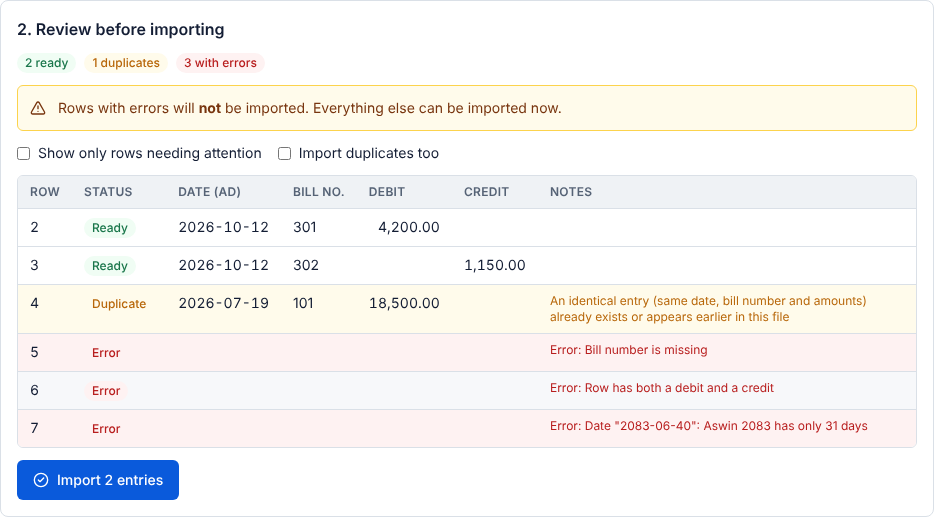

5. Fix problems in your file and upload again, or import only the good rows. Rows with errors are never imported. Rows already in the system are skipped as duplicates by default.
6. Press **Import**. A summary shows how many rows were imported, skipped and failed, and is kept in **Import history**.

> **PDF files:** a PDF with *typed* text (for example one saved from another program or exported from Excel) is read just like an Excel file: KusBill rebuilds the columns, you match them, and you see a preview with every problem flagged before anything is saved. After importing, you simply keep adding new entries and the running balance continues from the last imported row. A **photo or scan** of a paper page has no text to read and is refused with a clear message - use Bulk Entry or an Excel file for those. Tick *"PDF only: just keep it for reference"* if you only want to store the file.

---

## 8. Reports, printing and downloads

Click **Reports** to choose a report.

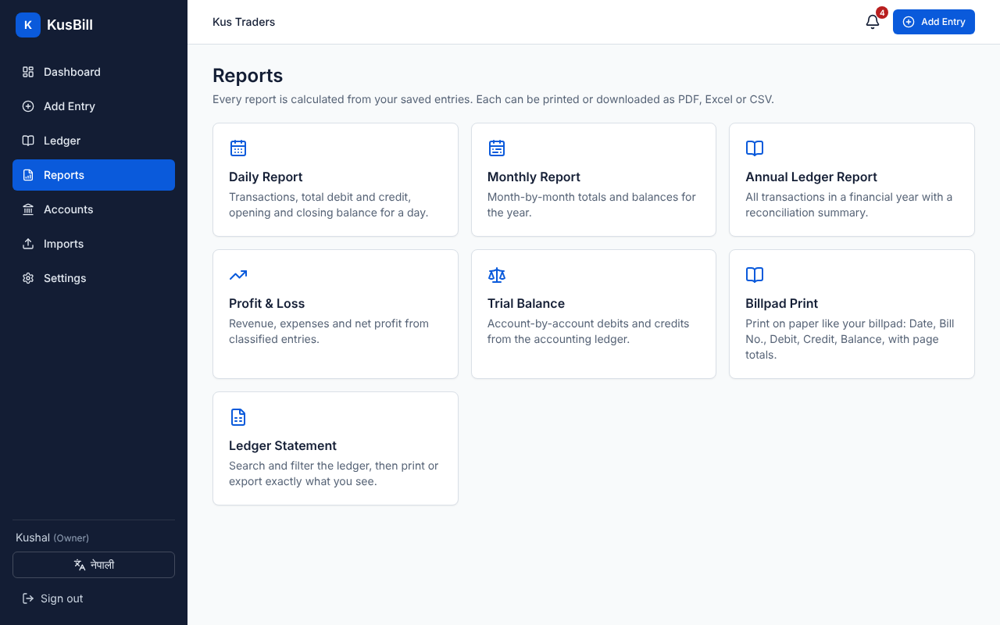

Every report has the same controls: pick the **period** (or the financial year), then use **PDF, Excel, CSV or Print**. Downloads always match what is on screen.

| Report | What it shows |
|---|---|
| **Daily Report** | For a day or range: number of transactions, total debit and credit, opening and closing balance, and that day's entries |
| **Monthly Report** | Month by month: transactions, opening balance, debit, credit and closing balance |
| **Annual Ledger Report** | The financial year's opening balance, **every** entry in order, totals, closing balance, and a **reconciliation summary** that checks the figures agree |
| **Profit & Loss** | Revenue minus expenses, by account |
| **Trial Balance** | Debit and credit totals by account (needs categorised entries) |
| **Billpad Print** | A printout that looks like your paper billpad |
| **Ledger Statement** | The ledger exactly as filtered |

### Monthly report

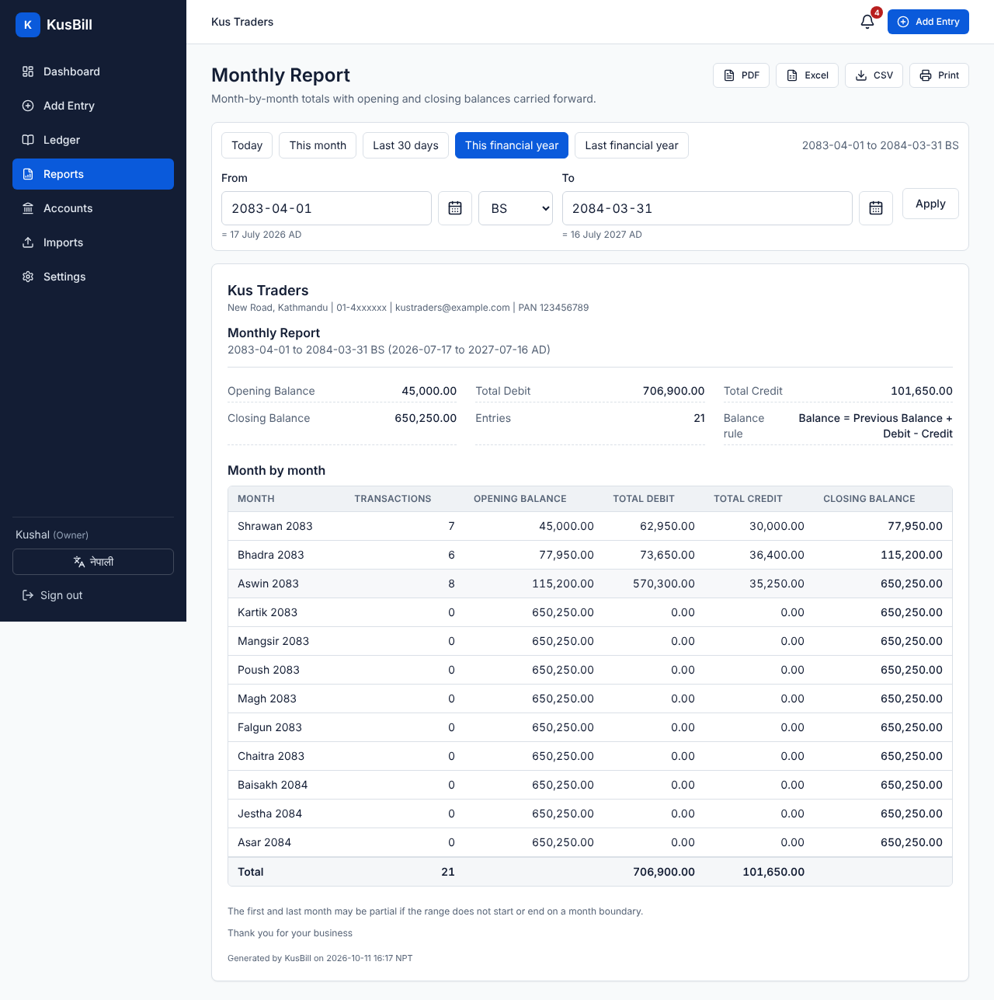

Each month's **closing balance becomes the next month's opening balance**. The balance is never reset by a new month or year.

### Annual ledger report

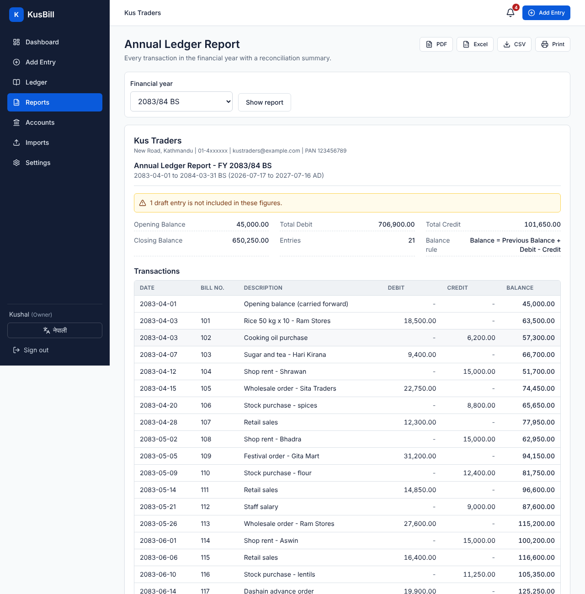

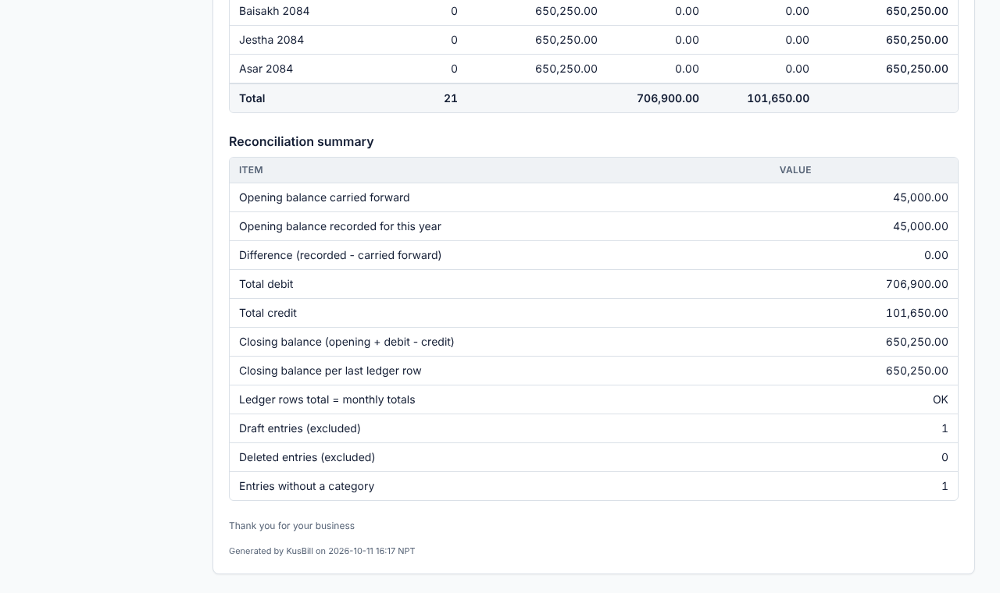

The **Reconciliation summary** at the bottom proves the report adds up: opening + debit − credit = closing, and the ledger rows agree with the monthly totals. If an opening balance you recorded for the year differs from the balance carried forward, a yellow note tells you by how much.

### Profit & Loss

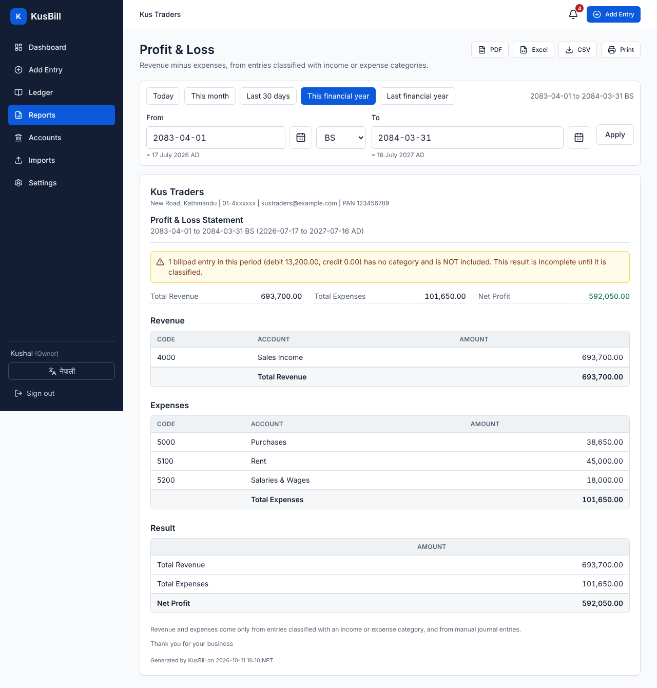

Revenue and expenses come **only from entries you gave a category**. If some entries have no category, a yellow warning says how many are left out, so you never mistake an incomplete figure for the final one. With no categorised entries at all it says **"Insufficient data"** and explains what to do.

### Billpad Print (like your paper pad)

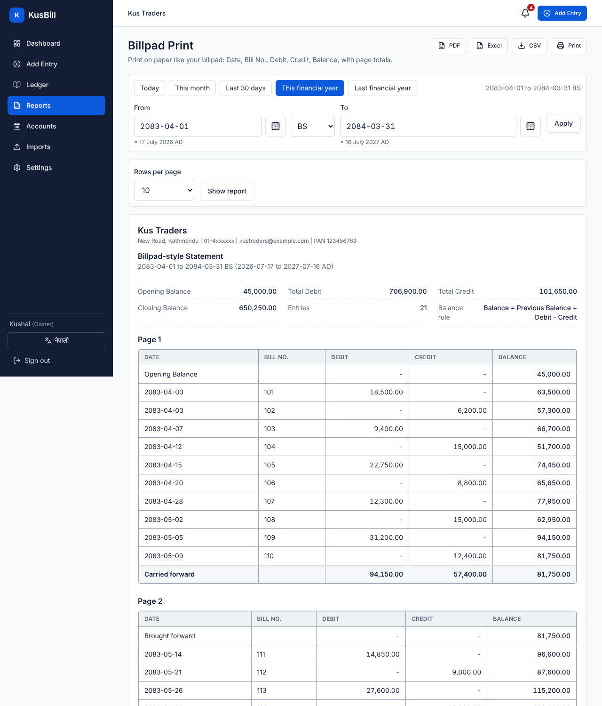

Choose the period and **Rows per page** (10 to 40). Each pad page starts with **Brought forward** and ends with the **page total** and **Carried forward**, just like turning a page of the real billpad. Use **Print** (or **PDF**) to get ruled, one-pad-page-per-sheet pages that you can place next to your paper billpad and compare.

---

## 9. Alerts and reminders

Click the **bell** in the top bar to open **Alerts and reminders**. These are gentle reminders, not errors.

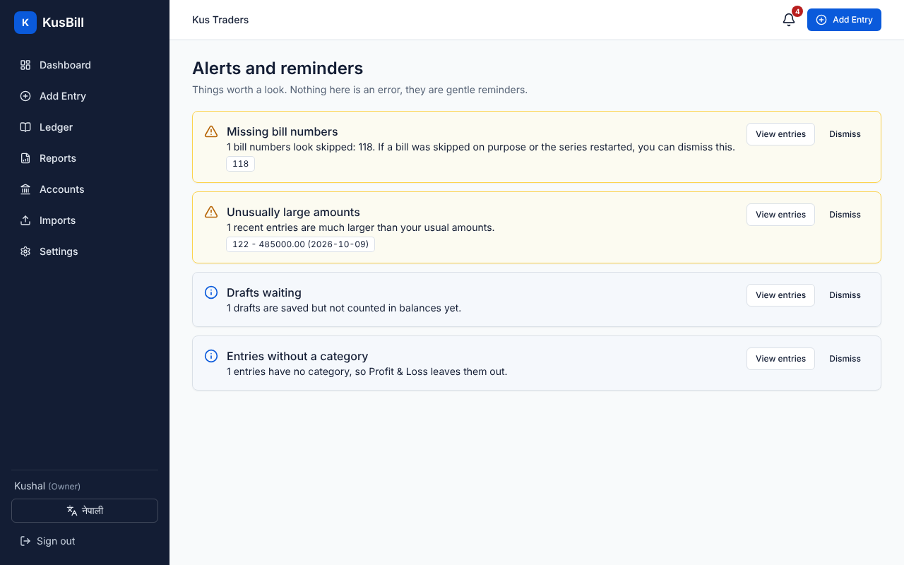

| Alert | Why it appears |
|---|---|
| **Missing bill numbers** | There is a gap in your numbered bills, for example 118 is missing between 117 and 119 |
| **Unusually large amounts** | A recent entry is far bigger than your usual amounts (often a typing mistake like an extra zero) |
| **Duplicate bill numbers** | The same bill number is used more than once |
| **Drafts waiting** | Drafts are saved but not counted yet |
| **Future-dated entries** | An entry has a date that has not happened yet |
| **No recent entries** | Nothing was added for three days or more |
| **Entries without a category** | These are left out of Profit & Loss |

Use **View entries** to go to the matching entries, or **Dismiss** to hide a reminder (for example, if a bill was skipped on purpose). A dismissed reminder only comes back if something new appears.

---

## 10. Accounts and categories (profit and loss)

A billpad only records a **debit** or **credit amount**. It does not say whether that money was a sale or an expense, so KusBill does not guess. You tell it by giving an entry a **category**.

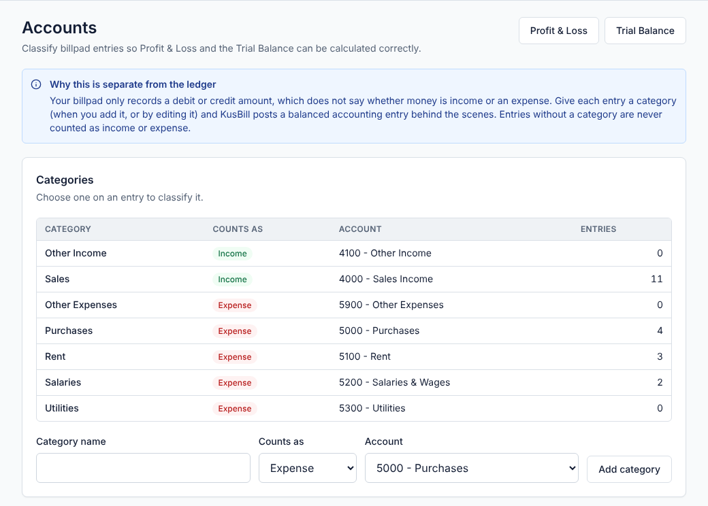

- **Categories** such as *Sales, Purchases, Rent, Salaries* are ready-made. Each counts as **Income** or **Expense**. Add your own with **Add category**.
- When you choose a category on an entry, KusBill quietly records a **balanced accounting entry** behind the scenes. You never have to think about debits and credits for this.
- Entries with **no category** are simply not counted as income or expense.
- **Manual journal entry** is for things that are not on the billpad (for example the owner putting money into the business). The two sides must be equal before it can be saved.
- **Chart of accounts** lists the accounts that categories use. Most users never need to change it.

---

## 11. Settings

Click **Settings** (owners can change everything; accountants can set opening balances and their own password).

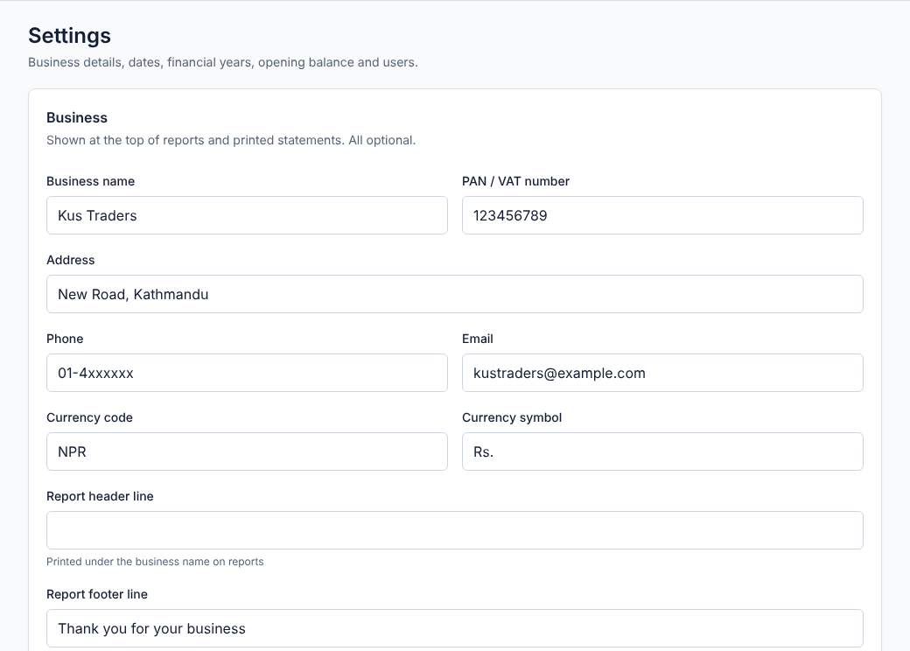

### Business details

Name, address, phone, PAN/VAT number, and optional header and footer lines for reports. Everything here is optional.

### Dates, numbers and sorting

- **Show dates in** BS or AD (the date you type is always kept exactly as typed).
- **Number format**: `1,234,567.00` or lakh style `12,34,567.00`.
- **Financial year** start (Nepal's standard year starts on **Shrawan 1**), and how the ledger is sorted by default.

### Balance rule

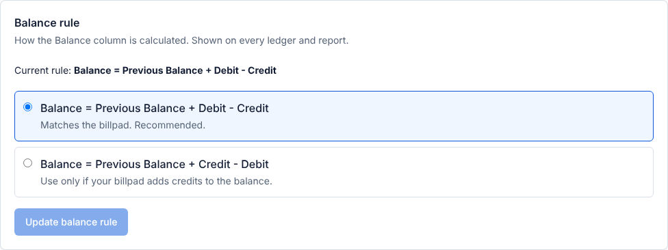

Default: **Balance = Previous + Debit − Credit** (matches the billpad). Changing it **does not change any amount you entered**, but it changes every balance shown, so KusBill asks you to tick a confirmation first and records the change.

### Financial years and opening balance

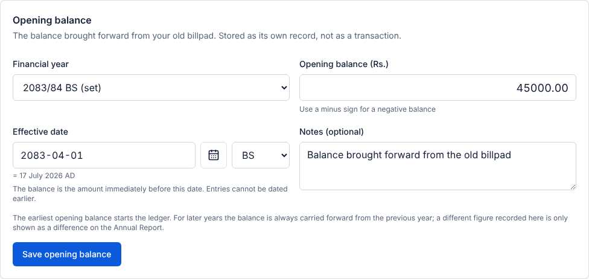

- **Add a financial year** with the number of the year it starts in.
- **Opening balance** is the balance brought forward from the old billpad. Choose the year, type the amount and the **effective date**. Entries cannot be dated before that date.
- For later years the balance is **carried forward automatically** from the year before. You do not need to type it again.

### Users

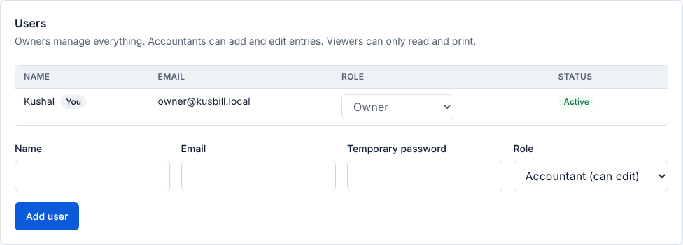

The owner can add people and choose what each can do:

| Role | Can do |
|---|---|
| **Owner** | Everything, including settings and users |
| **Accountant** | Add, edit, delete and reverse entries, import, reports |
| **Viewer** | Read, search, print and download only |

Use **Disable** to stop someone signing in. They are signed out straight away.

### My account

Change your name and password. After a password change, your other devices are signed out.

### Backup

**Settings → Backup and recovery → Download full backup (JSON)** saves a copy of all your records. Do this regularly and keep the file somewhere safe (not only on the same computer). The server administrator should also keep automatic database backups.

### Recent activity

A list of the latest changes (who, what and when) for the owner.

---

## 12. Nepali language

Press the **नेपाली** button (bottom of the left menu, or on the sign-in and setup pages) to switch every screen to Nepali. Press **English** to switch back. The choice is remembered on that device.

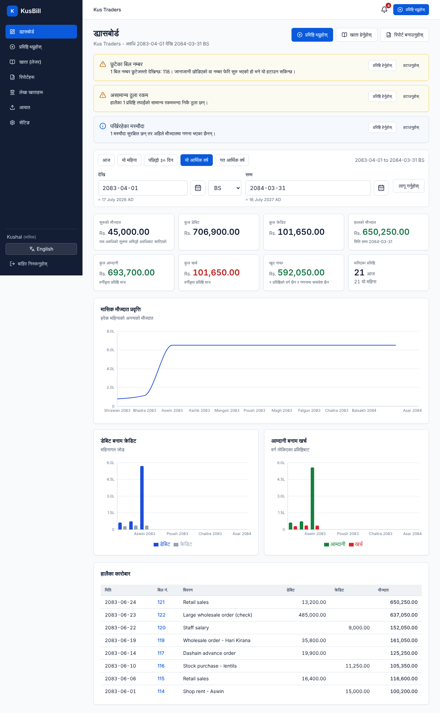

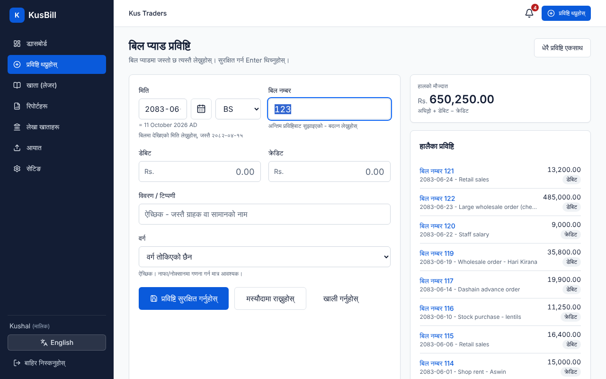

- **Reports, PDFs, Excel and CSV files follow the language you have selected**, and Nepali text prints correctly in PDFs.
- Money amounts, bill numbers and dates stay in normal digits.
- A few long explanations in Settings, Accounts and Imports may still appear in English.

---

## 13. When the internet stops

You can keep entering bills if the connection drops.

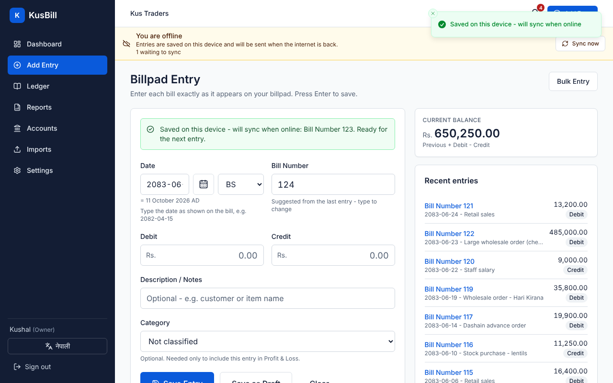

- If you press **Save** and there is no internet, KusBill keeps the entry **on this device** and shows *"Saved on this device - will sync when online"*. A yellow bar at the top shows how many entries are waiting.
- When the internet returns, the entries are **sent automatically, in the same order**, and a message confirms it. You can also press **Sync now**.
- Each waiting entry has a unique tag, so even if it is sent twice it is **saved only once**.
- If the server rejects an entry when it syncs (for example, an identical entry already exists), it is listed under **Needs attention** with **Retry / Save anyway / Discard**. Nothing is lost silently.
- If you reload the page while offline, a small **offline page** appears where you can still type bills.

Please note: this covers **adding** entries. To **view or change** existing records you need an internet connection. Waiting entries are kept in this browser, so use the feature only on a device you trust, and sync before switching to another device.

---

## 14. Using a phone

KusBill works in a phone's browser. The menu is behind the **☰** button, and entry, ledger and reports are laid out for a small screen.

<table>
<tr>
<td>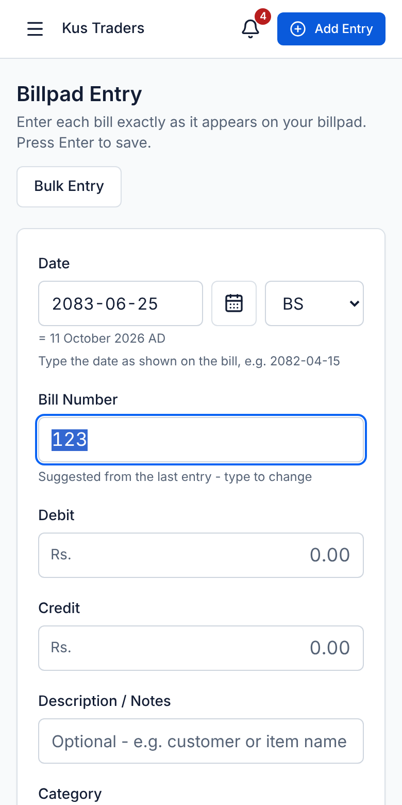</td>
<td>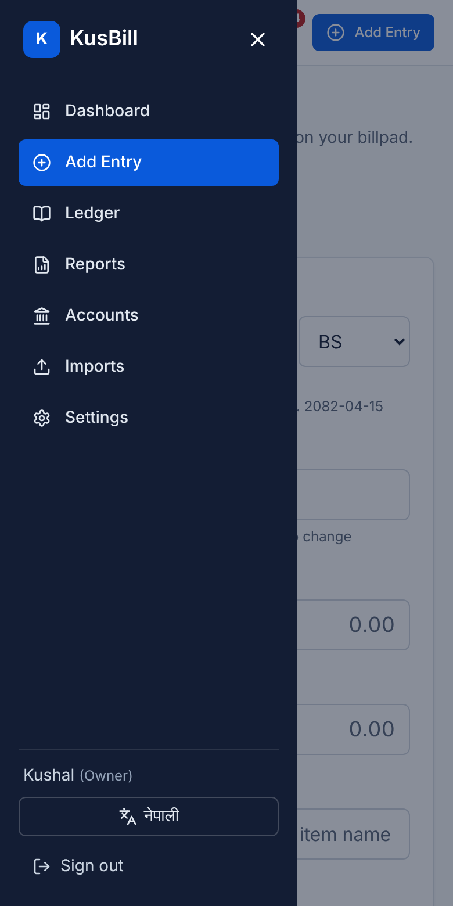</td>
<td>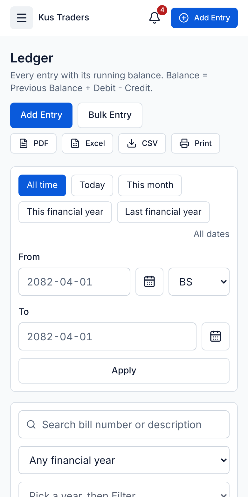</td>
</tr>
</table>

---

## 15. Quick reference

### Keyboard shortcuts

| Where | Keys | Does |
|---|---|---|
| Entry form | **Enter** | Save the entry |
| Ledger quick-add row | **Enter** | Add the entry and return to *Bill No.* |
| Ledger cell | **Double-click** or **Enter** | Start editing |
| Editing a cell | **Enter** / **Esc** | Save / cancel |
| Ledger and bulk grid | **↑ ↓** | Move between rows |
| Bulk grid | **Enter** | Go down one row |
| Date picker | **Esc** | Close |

### Everyday checklist

- **Every day:** add the day's bills; glance at the **bell** for reminders.
- **Every week:** check the **Ledger** against the physical billpad (use **Billpad Print** to compare page by page).
- **Every month:** open the **Monthly Report**; print or save the PDF.
- **Every year:** open the **Annual Ledger Report**, check the reconciliation, and save the PDF and a **backup**.

---

## 16. Questions and problems

**I made a mistake in an entry.**
Double-click the wrong cell in the **Ledger** and fix it. Balances update by themselves. The change is recorded in the entry's history.

**I entered a bill twice.**
Open the extra entry and press **Delete** (give a short reason). The balance corrects itself.

**The balance does not match my billpad.**
Check, in this order: (1) the **opening balance** and its date in Settings; (2) the **balance rule** in Settings; (3) use **Billpad Print** for the same dates and compare page by page to find the first row that differs; (4) look for an entry with the wrong date or a missing bill number in **Alerts**.

**It says "Date is before the opening balance date".**
The opening balance covers everything up to its effective date. Either use a later date, or move the opening balance's effective date earlier in **Settings → Opening balance**.

**A date shows an error such as "Shrawan 2083 has only 32 days".**
KusBill knows exactly how many days each Nepali month has. Check the day number against the calendar.

**Profit & Loss says "Insufficient data" or shows a warning.**
Give entries a **category** (Sales, Purchases, Rent…). Entries without a category are not counted as income or expense.

**I forgot my password.**
Ask the **owner** to disable and re-add your user, or to reset it. (There is no password email yet.)

**Why does the Nepali PDF look different from the screen?**
It uses a fixed, print-friendly layout so it is clear on paper. The figures are the same.

**Where is my data stored?**
On the business's secure server database, not in your browser. The browser only keeps a temporary copy of unsent offline entries and small preferences (language, hidden reminders).

---

## 17. Short guide in Nepali

**KusBill के हो?**
यो तपाईंको बिल प्याडको डिजिटल रूप हो। मिति, बिल नम्बर र रकम लेख्नुहोस्; मौज्दात र रिपोर्ट आफैं तयार हुन्छन्।

**कसरी चलाउने?**
1. ब्राउजरमा KusBill खोलेर इमेल र पासवर्डले **प्रवेश गर्नुहोस्**।
2. सुरुमा **सुरुको मौज्दात** (प्याडको अघिल्लो बाँकी रकम) राख्नुहोस्।
3. **प्रविष्टि थप्नुहोस्** थिचेर मिति, बिल नम्बर र **डेबिट वा क्रेडिट** रकम लेखेर **Enter** थिच्नुहोस्।
4. गल्ती भए **खाता (लेजर)** मा गएर खानामा दुई पटक क्लिक गरी सच्याउनुहोस्। मौज्दात आफैं मिल्छ।
5. धेरै बिल एकैचोटि लेख्न **धेरै प्रविष्टि एकसाथ** प्रयोग गर्नुहोस्; Excel बाट कपी गरेर पेस्ट पनि गर्न मिल्छ।
6. **रिपोर्टहरू** बाट दैनिक, मासिक, वार्षिक हिसाब र नाफा-नोक्सान हेर्नुहोस्। **बिल प्याड प्रिन्ट** ले प्याडजस्तै कागज दिन्छ। PDF, Excel वा प्रिन्ट गर्न सकिन्छ।
7. माथि/बायाँको **नेपाली** बटनले भाषा बदल्न सकिन्छ।
8. इन्टरनेट गए पनि लेख्न सकिन्छ; इन्टरनेट आएपछि आफैं सुरक्षित हुन्छ।
9. **घण्टी (🔔)** मा छुटेको बिल नम्बर, असामान्य ठूलो रकम आदि सम्झना देखिन्छ।

**ध्यान दिनुहोस्:** आफ्नो पासवर्ड कसैलाई नदिनुहोस्, र नियमित रूपमा **सेटिङ → ब्याकअप** बाट बचत प्रति डाउनलोड गर्नुहोस्।

---

## 18. Glossary

| Term | Meaning |
|---|---|
| **Billpad** | The paper pad of bills with Date, Bill No., Debit, Credit and Balance columns |
| **Debit / Credit** | The two amount columns. Which one adds to the balance is set by the *balance rule* |
| **Balance** | The running total after each entry |
| **Opening balance** | The amount brought forward when you start (or begin a year) |
| **Closing balance** | The balance at the end of a period: opening + debit − credit (by default) |
| **Carried forward** | The closing balance of one period used as the opening balance of the next |
| **Ledger** | The list of all entries with their balances |
| **Financial year** | Your accounting year (in Nepal, normally starting Shrawan 1) |
| **BS / AD** | Bikram Sambat (Nepali) calendar / Gregorian (English) calendar |
| **Category** | A label such as *Sales* or *Rent* that tells KusBill whether an entry is income or an expense |
| **Draft** | A saved but not yet counted entry |
| **Reversal** | An entry that cancels an earlier one by swapping debit and credit |
| **Reconciliation** | A check that all the totals in a report agree with each other |
| **Profit & Loss** | Income minus expenses for a period |
| **Trial balance** | A list of totals by account, showing that debits equal credits |
